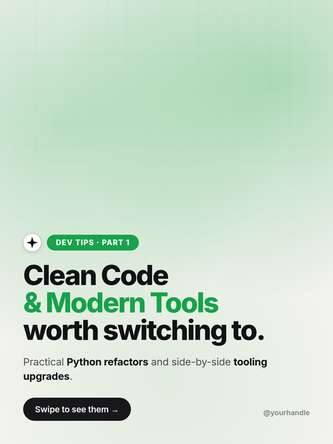
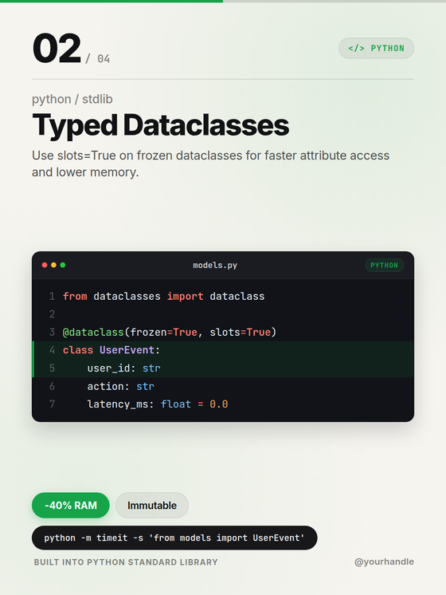
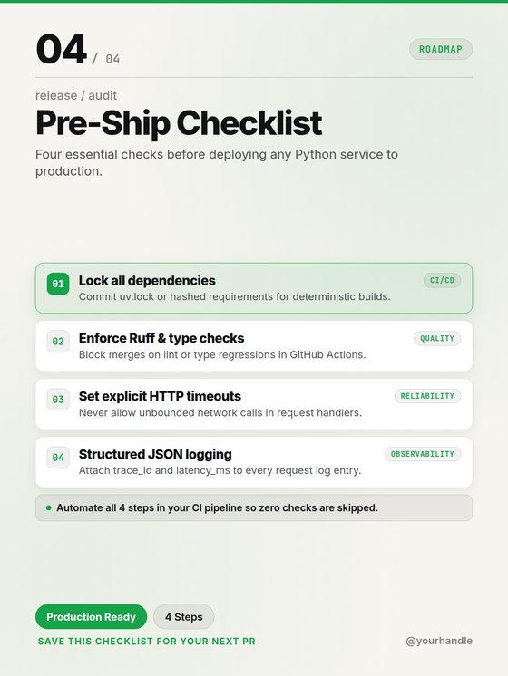
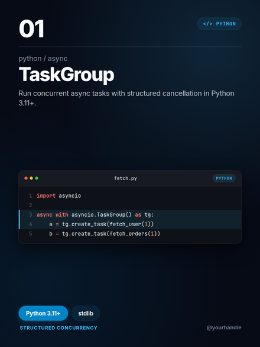
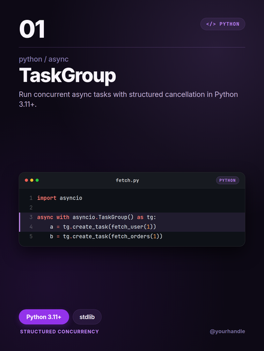
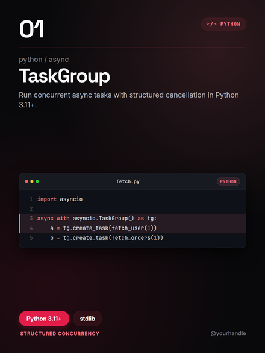

<div align="center">

# TCD-Swipekit

**Turn GitHub repos, useful websites, Markdown articles, code diffs, and comparisons into high-resolution social media carousels from a single CLI command.**

Built for **TikTok Photo Mode**, **Instagram Carousels**, **LinkedIn Document PDFs**, **Animated GIFs**, and **Reels / Shorts**.

[](https://www.python.org/)
[](LICENSE)
[](https://docs.astral.sh/ruff/)
[](#extending-tcd-swipekit-plugin-architecture)
[](#install-as-an-ai-agent-skill)

[Showcase](#showcase) · [Features](#features) · [Quick Start](#quick-start) · [Slide Layouts](#slide-layouts) · [Extensibility & Plugins](#extending-tcd-swipekit-plugin-architecture) · [Themes](#4-built-in-themes-8-modern-dark--light-presets) · [CLI Reference](#cli-reference)

<br />


</div>

---

## Showcase

### 1. Multi-Layout Carousel (`Cover` · `Diff` · `Code` · `Checklist` · `Closing CTA`)

Generated directly from [`examples/code_and_versus_deck.yaml`](examples/code_and_versus_deck.yaml) or [`examples/python_tips_article.md`](examples/python_tips_article.md) (`--theme editorial-light`):

<table>
  <tr>
    <td align="center" width="20%">
      <br />
      <sub><b>01 · Cover Hook</b><br />Gradient mesh &amp; accent lines</sub>
    </td>
    <td align="center" width="20%">
      <br />
      <sub><b>02 · Diff Code</b><br /><code>layout: code</code> + <code>diff_mode</code></sub>
    </td>
    <td align="center" width="20%">
      <br />
      <sub><b>03 · Code Snippet</b><br />Pygments + <code>highlight_lines</code></sub>
    </td>
    <td align="center" width="20%">
      <br />
      <sub><b>05 · Checklist</b><br /><code>layout: checklist</code> + badges</sub>
    </td>
    <td align="center" width="20%">
      <br />
      <sub><b>06 · Closing CTA</b><br />Save / Follow / Comment</sub>
    </td>
  </tr>
</table>

### 2. Multi-Ratio Auto-Adaptation (`3:4` Portrait → `1:1` LinkedIn PDF)

Export multiple aspect ratios (`--ratios 3:4,4:5,1:1`), a combined `carousel.pdf` (`--pdf`), and an animated `carousel.gif` (`--gif`) in a single run without re-fetching sources. Notice how `layout: versus` automatically switches from **vertical stacked** (`3:4` / `4:5`) to **2-column side-by-side** (`1:1`):

<table>
  <tr>
    <td align="center" width="50%">
      <br />
      <sub><b>TikTok / Reels (<code>3:4</code> · 1180×1572)</b> — Stacked mobile cards</sub>
    </td>
    <td align="center" width="50%">
      <br />
      <sub><b>LinkedIn PDF (<code>1:1</code> · 1080×1080)</b> — Side-by-side comparison</sub>
    </td>
  </tr>
</table>

### 3. Interactive `preview.html`, Safe-Zone HUD & Live Watch Server (`swipekit watch`)

Every export includes an interactive `preview.html` with keyboard navigation (`←` / `→`), toggleable **Platform Safe-Zone Overlays** (`S` key) for **TikTok**, **IG Reels**, **IG Carousel**, and **LinkedIn**, plus live hot-reload when running `swipekit watch`:

<p align="center">
  
</p>

### 4. Built-in Themes (8 Modern Dark & Light Presets)

Pick your preferred theme with `--theme` (default: `midnight-emerald`), drop `.yaml` themes into `./themes/` or `~/.config/swipekit/themes/`, or pass `--theme ./my_brand.yaml` with dynamic Google Fonts or offline `font_files`:

<table>
  <tr>
    <td align="center" width="25%">
      <br />
      <sub><code>editorial-light</code> · Light Cream</sub>
    </td>
    <td align="center" width="25%">
      <br />
      <sub><code>arctic-slate</code> · Light Cobalt</sub>
    </td>
    <td align="center" width="25%">
      <br />
      <sub><code>midnight-emerald</code> · Default</sub>
    </td>
    <td align="center" width="25%">
      <br />
      <sub><code>nord-frost</code> · Glacier Teal</sub>
    </td>
  </tr>
  <tr>
    <td align="center" width="25%">
      <br />
      <sub><code>cyber-indigo</code> · Deep Sky</sub>
    </td>
    <td align="center" width="25%">
      <br />
      <sub><code>neon-violet</code> · Ultraviolet</sub>
    </td>
    <td align="center" width="25%">
      <br />
      <sub><code>amber-noir</code> · Carbon Gold</sub>
    </td>
    <td align="center" width="25%">
      <br />
      <sub><code>crimson-carbon</code> · Signal Rose</sub>
    </td>
  </tr>
</table>

Run `swipekit themes` to list all installed presets.

---

## Features

- **4 Built-in Content Sources + Pluggable Source Registry**
  - **GitHub Source (`generate github`):** Pulls trending repos (`daily` / `weekly` / `monthly`) or topic searches, live star counts, licenses, and smart-cropped README visuals.
  - **Website Source (`generate web`):** Captures crisp desktop screenshots from `sites.yml` via headless Chromium (with cookie-banner dismissal, OpenGraph metadata, and **Browser / macOS window frames**).
  - **Markdown-to-Carousel (`generate markdown`):** Converts any `.md` article, tutorial, or remote Markdown URL into a multi-layout deck — automatically detecting `code` blocks, `versus` comparisons, `checklist` steps, and `showcase` cards.
  - **Hybrid YAML Decks (`render`):** Mix any source and slide layout in one editable `deck.yaml`.
- **4 Built-in Slide Layouts + Custom Jinja2 Layout Templates**
  - `showcase` (with `frame: browser | macos | none`), `code` (Pygments syntax highlighting + `diff_mode` + `highlight_lines`), `versus` (A-vs-B comparison), and `checklist` (roadmaps, audits & numbered steps) — plus top **Progress Track & Step Counter (`01 / 04`)**.
- **Multi-Ratio Batch, LinkedIn PDF & Animated GIF Export**
  - Supported ratios: `3:4` (`1180×1572`), `4:5` (`1080×1350`), `9:16` (`1080×1920`), `1:1` (`1080×1080`).
  - Render multiple ratios in one pass (`--ratios 3:4,4:5,1:1`), bundle `carousel.pdf` (`--pdf`), and export an animated `carousel.gif` (`--gif`).
- **Live Watch & Hot-Reload Server (`swipekit watch`)**
  - Watches `deck.yaml`, `article.md`, and custom themes, re-rendering on save and hot-reloading your browser preview at `http://127.0.0.1:8765`.
- **First-Class Extensibility (`swipekit plugins`)**
  - Register custom sources (`@register_source`), custom slide layouts (`@register_layout` or drop-in `slide_<name>.html.j2`), custom bundle exporters (`@register_exporter`), and custom theme directories via Python entry points, `~/.config/swipekit/plugins/*.py`, or `--plugin ./my_plugin.py`.

---

## Quick Start

### 1. Install & Run

Clone the repository first:

```bash
git clone https://github.com/try-catch-dev/TCD-Swipekit.git
cd TCD-Swipekit
```

#### Option A — Using `uv` *(Recommended — Fast & Isolated)*

```bash
# Create virtual environment & install dependencies with uv
uv venv
source .venv/bin/activate        # Windows: .venv\Scripts\activate
uv pip install -e ".[dev]"
playwright install chromium
swipekit doctor

# Or run commands directly via `uv run` without manually activating the venv:
uv run playwright install chromium
uv run swipekit doctor
uv run swipekit render examples/code_and_versus_deck.yaml --theme editorial-light --pdf
```

*(You can also install `swipekit` globally as a standalone CLI tool via `uv tool install git+https://github.com/try-catch-dev/TCD-Swipekit.git`.)*

#### Option B — Using Standard Python Virtual Environment (`venv` + `pip`)

```bash
# 1. Create and activate a virtual environment
python3 -m venv .venv
source .venv/bin/activate        # Windows (PowerShell): .venv\Scripts\Activate.ps1
                                 # Windows (CMD):        .venv\Scripts\activate.bat

# 2. Install TCD-Swipekit and Playwright Chromium
pip install --upgrade pip
pip install -e ".[dev]"
playwright install chromium

# 3. Verify your setup
swipekit doctor
```

### 2. Try the Demo Deck or Markdown-to-Carousel (Offline, Zero API Keys)

```bash
# Render the multi-layout YAML demo across 3:4, 4:5, and 1:1 + PDF + Animated GIF
swipekit render examples/code_and_versus_deck.yaml \
  --theme editorial-light \
  --ratios 3:4,4:5,1:1 \
  --pdf --gif \
  --output ./out/demo

# Or convert a Markdown article directly into a carousel deck
swipekit generate markdown examples/python_tips_article.md \
  --theme editorial-light \
  --outro --pdf --gif \
  --output ./out/from_markdown
```

### 3. Live Watch & Hot-Reload While Editing

```bash
swipekit watch examples/code_and_versus_deck.yaml --theme editorial-light --port 8765
```

### 4. Generate from GitHub Trending or Websites (`sites.yml`)

```bash
# GitHub Trending / Topic search
swipekit generate github \
  --topic "ai" \
  --limit 5 \
  --theme midnight-emerald \
  --watermark "@yourhandle" \
  --outro --pdf \
  --output ./out/github_ai

# Auto-screenshotted websites in Browser Mockup Frames
swipekit init sites
swipekit generate web --sites examples/sites.yml --outro --pdf --output ./out/useful_websites
```

---

## Slide Layouts

Every item in `deck.yaml` supports four built-in layouts (`layout` is auto-inferred when `code_block`, `versus`, or `checklist` is present) plus custom plugin layouts:

| Layout | Purpose | Key YAML Fields |
| :--- | :--- | :--- |
| `showcase` *(default)* | GitHub repo, website screenshot, or product card | `screenshot_path`, `frame` (`browser` \| `macos` \| `none`), `repo`, `url`, `badges` |
| `code` | Syntax-highlighted code window or terminal diff | `code_block.code`, `language`, `filename`, `diff_mode`, `highlight_lines` |
| `versus` | Before/After or Tool A vs Tool B comparison | `versus.left`, `versus.right`, `points`, `code`, `accent`, `verdict` |
| `checklist` | Actionable checklist, roadmap, or numbered steps | `checklist.items` (`title`, `detail`, `badge`, `accent`), `numbered`, `summary` |
| `<custom>` | Any user/plugin layout (`slide_<name>.html.j2`) | `layout: <name>`, `custom_template`, `extra: { ... }` |

<details>
<summary><b>Example: <code>code</code>, <code>versus</code> &amp; <code>checklist</code> YAML snippet</b></summary>

```yaml
items:
  - source: manual
    eyebrow: "python / refactor"
    title: "Avoid N+1 Loops"
    description: "Replace nested dictionary lookups with a single indexed dict comprehension."
    code_block:
      filename: "orders_service.py"
      language: "diff"
      diff_mode: true
      code: |
        - for order in orders:
        -     for u in users:
        -         if u["id"] == order["user_id"]:
        -             order["user"] = u
        + user_by_id = {u["id"]: u for u in users}
        + for order in orders:
        +     order["user"] = user_by_id.get(order["user_id"])

  - source: manual
    eyebrow: "python / packaging"
    title: "pip vs uv"
    description: "Why modern Python teams migrate local & CI workflows to uv."
    versus:
      left:
        label: "pip + venv"
        badge: "LEGACY"
        points: ["Slow resolution on large repos", "Multiple separate CLIs"]
        code: "pip install -r requirements.txt"
      right:
        label: "uv"
        badge: "RECOMMENDED"
        points: ["10–100× faster installs", "Single Rust binary + lockfile"]
        code: "uv sync --frozen"
        accent: true
      verdict: "Switch to uv for instant setups and 5× faster CI."

  - source: manual
    eyebrow: "release / audit"
    title: "Pre-Ship Checklist"
    description: "Four essential checks before deploying any Python service to production."
    checklist:
      numbered: true
      items:
        - { title: "Lock all dependencies", detail: "Commit uv.lock for deterministic builds.", badge: "CI/CD", accent: true }
        - { title: "Enforce Ruff & type checks", detail: "Block merges on lint regressions.", badge: "QUALITY" }
        - { title: "Set explicit HTTP timeouts", detail: "Never allow unbounded network calls.", badge: "RELIABILITY" }
      summary: "Automate all checks in your GitHub Actions CI pipeline."
```

</details>

---

## Extending TCD-Swipekit (Plugin Architecture)

TCD-Swipekit is designed to be extended without editing core files. Inspect all active extension points at any time with:

```bash
swipekit plugins
```

### 1. Drop-in Custom Themes & Jinja2 Layout Templates (Zero Python)
- **Custom Themes:** Drop any `.yaml` theme file into `./themes/` or `~/.config/swipekit/themes/` and use it immediately via `--theme <name>`.
- **Custom Slide Layouts:** Drop `slide_<name>.html.j2` into `./templates/` or `~/.config/swipekit/templates/`, then set `layout: <name>` and `extra: { ... }` on any slide in `deck.yaml` (or set `custom_template: ./my_slide.html.j2` per item).

### 2. Python Plugins (Custom Sources, Layouts & Exporters)

Scaffold a starter plugin with `swipekit init plugin`:

```python
# swipekit_plugin.py
from pathlib import Path
from tcd_swipekit import (
    BadgeStyle,
    BaseSource,
    DeckSpec,
    SlideBadge,
    SlideItem,
    register_exporter,
    register_layout,
    register_source,
)

@register_source("hn-top", description="Fetch top stories from Hacker News")
class HackerNewsSource(BaseSource):
    def fetch_items(self, limit: int = 5, **kwargs: object) -> list[SlideItem]:
        tag = str(kwargs.get("tag", "show-hn"))
        return [
            SlideItem(
                source="hn-top",
                eyebrow=f"news.ycombinator.com / {tag}",
                title=f"Show HN Project #{i}",
                description="Fetched dynamically from your custom source plugin.",
                badges=[SlideBadge(text="HN Top", style=BadgeStyle.ACCENT)],
            )
            for i in range(1, limit + 1)
        ]

@register_exporter("json", filename="manifest.json", description="Export slide manifest as JSON")
def export_manifest(slide_paths: list[Path], output_path: Path, deck: DeckSpec) -> Path:
    import json
    output_path.write_text(json.dumps({"topic": deck.topic, "slides": [p.name for p in slide_paths]}, indent=2))
    return output_path
```

Run your plugin via `--plugin` (or place it in `~/.config/swipekit/plugins/` to auto-load globally, or publish a Python package with `[project.entry-points."tcd_swipekit.plugins"]`):

```bash
swipekit generate custom hn-top \
  --plugin ./swipekit_plugin.py \
  --opt tag=show-hn \
  --export json \
  --output ./out/hn_deck
```

---

## CLI Reference

| Command | Description |
| :--- | :--- |
| `swipekit generate github [OPTIONS]` | Fetch trending/topic GitHub repos & render carousel |
| `swipekit generate web --sites sites.yml [OPTIONS]` | Auto-capture website screenshots & render carousel |
| `swipekit generate markdown article.md [OPTIONS]` | Convert a Markdown file or URL into a multi-layout carousel |
| `swipekit generate custom <source> [OPTIONS]` | Generate a carousel from any registered custom `BaseSource` plugin |
| `swipekit render deck.yaml [OPTIONS]` | Render or re-render a custom/hybrid YAML deck |
| `swipekit watch <deck.yaml\|article.md> [OPTIONS]` | Watch file changes, auto-re-render & serve live browser preview |
| `swipekit init [sites\|deck\|markdown\|profile\|plugin]` | Scaffold starter `sites.yml`, `deck.yaml`, `article.md`, `.swipekit.yaml`, or `swipekit_plugin.py` |
| `swipekit plugins` | List all registered sources, slide layouts, exporters & search paths |
| `swipekit profile` | Show active Creator Brand Profile & resolved defaults |
| `swipekit themes` | List available theme presets (built-in + user directories) |
| `swipekit doctor` | Verify Python, Chromium/Playwright, dependencies, registry & skill status |
| `swipekit skill install --agent <name>` | Install the TCD-Swipekit AI Agent Skill (`antigravity`, `claude`, `cursor`, `all`, etc.) |
| `swipekit skill update [--remote]` | Update all installed Agent Skills from local package or remote GitHub (`swipekit update`) |
| `swipekit skill status` | Check installation & SHA-256 sync status across all AI coding agents |

**Shared Flags:** `--ratios 3:4,4:5,1:1` (or `all`) · `--pdf` · `--gif` · `--export <name>` · `--outro / --no-outro` · `--theme <preset|file.yaml>` · `--lang en|id` · `--watermark "@handle"` · `--plugin <file.py>` · `--profile <file>` · `--no-profile` · `--ai`

---

## Install & Auto-Update as an AI Agent Skill

TCD-Swipekit follows the **Agent Skills Open Standard** ([`skills/tcd-swipekit/SKILL.md`](skills/tcd-swipekit/SKILL.md)), compatible with **Antigravity, Claude Code, Codex, Cursor, Gemini CLI, and GitHub Copilot**.

```bash
# Option 1 — Via skills CLI (npx)
npx skills add try-catch-dev/TCD-Swipekit

# Option 2 — Via built-in swipekit CLI
swipekit skill install --agent antigravity   # or gemini, claude, codex, cursor, copilot, all
swipekit skill status

# Update all installed agent skills (from local package or directly from GitHub!)
swipekit skill update
swipekit skill update --remote               # or shortcut: swipekit update --remote
```

> **Automatic Skill Sync:** Whenever you upgrade `tcd-swipekit` (`git pull` or `pip install -U tcd-swipekit`), running any `swipekit` command automatically checks the SHA-256 content digest of your installed Agent Skills and silently syncs outdated `SKILL.md` / `references/` in-place (disable anytime with `auto_update_skill: false` in `.swipekit.yaml` or `SWIPEKIT_NO_AUTO_SKILL_UPDATE=1`).

---

## Environment Variables (Optional)

TCD-Swipekit runs **100% without API keys** by default. Two optional environment variables unlock extra capacity:

- **`GITHUB_TOKEN`** — Raises the GitHub API rate limit from 60 to 5,000 requests/hour when generating many GitHub decks.
- **`OPENAI_API_KEY`** (with `pip install -e ".[ai]"`) — Enables `--ai` to polish descriptions with an OpenAI-compatible LLM (`OPENAI_BASE_URL` and `SWIPEKIT_AI_MODEL` are also supported).

---

## Project Structure

```text
TCD-Swipekit/
├── docs/assets/                  # README showcase visuals
├── examples/                     # Ready-to-run sites.yml, deck.yaml, code_and_versus_deck.yaml & python_tips_article.md
├── skills/tcd-swipekit/          # Agent Skills standard SKILL.md + schema/theme references
├── src/tcd_swipekit/
│   ├── cli.py                    # Typer + Rich CLI (`swipekit`)
│   ├── pipeline.py               # Orchestration API (GitHub, Web, Markdown, Custom Sources, Multi-Ratio)
│   ├── plugins.py                # Extensibility registry (Sources, Layouts, Exporters, Entry Points)
│   ├── watcher.py                # Live file watcher & hot-reload HTTP preview server (`swipekit watch`)
│   ├── profile.py                # Creator Brand Profile discovery & loader
│   ├── models.py                 # Pydantic v2 schemas (DeckSpec, CodeBlock, VersusBlock, ChecklistBlock)
│   ├── i18n.py                   # EN (default) & ID localization
│   ├── copywriter.py             # Cover/outro defaults, caption builder, optional AI enhancer
│   ├── image_utils.py            # Smart border cropping & ambient color extraction
│   ├── renderer.py               # Jinja2 + Playwright PNG/PDF/GIF renderer + Pygments highlighter
│   ├── sources/                  # github.py, website.py, markdown.py, manual.py, base.py
│   └── themes/
│       ├── loader.py             # Preset, user directory & custom YAML theme loader (with local font_files)
│       ├── presets/              # 8 built-in dark & light presets (+ custom .yaml)
│       └── templates/            # cover, slide, slide_code, slide_versus, slide_checklist, outro, preview
└── tests/
```

---

## Contributing & Community

Contributions are welcome — new theme presets, slide layouts, exporters, and content sources make great first PRs!

- [Contributing Guide](CONTRIBUTING.md) · [Changelog](CHANGELOG.md) · [Code of Conduct](CODE_OF_CONDUCT.md) · [Security Policy](SECURITY.md)

```bash
ruff check src tests
pytest -v
```

## License

MIT © [Try Catch Dev](https://github.com/try-catch-dev)
