<div align="center">

# TCD-Swipekit

**Turn GitHub repos, useful websites, code diffs, and comparisons into high-resolution social media carousels from a single CLI command.**

Built for **TikTok Photo Mode**, **Instagram Carousels**, **LinkedIn Document PDFs**, and **Reels / Shorts**.

[](https://www.python.org/)
[](LICENSE)
[](https://docs.astral.sh/ruff/)
[](#install-as-an-ai-agent-skill)

[Showcase](#showcase) · [Features](#features) · [Quick Start](#quick-start) · [Slide Layouts](#slide-layouts) · [Themes](#built-in-themes) · [CLI Reference](#cli-reference) · [AI Agent Skill](#install-as-an-ai-agent-skill)

<br />

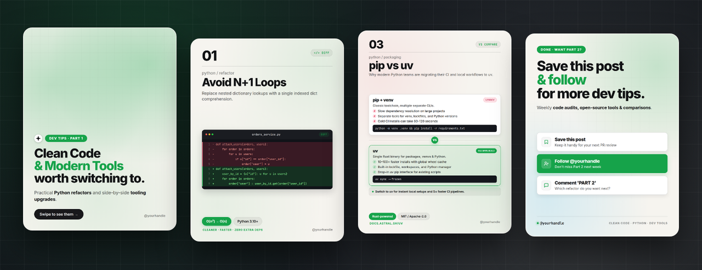

</div>

---

## Showcase

### 1. Code, Diff & Versus Carousel (`3:4` · `1180×1572`)

Generated directly from [`examples/code_and_versus_deck.yaml`](examples/code_and_versus_deck.yaml) using `swipekit render`:

<table>
  <tr>
    <td align="center" width="25%">
      <br />
      <sub><b>01 · Cover Hook</b><br />Gradient mesh &amp; accent lines</sub>
    </td>
    <td align="center" width="25%">
      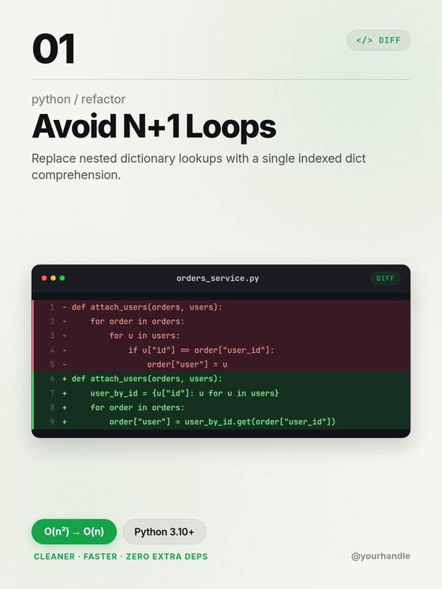<br />
      <sub><b>02 · Diff Code</b><br /><code>layout: code</code> + <code>diff_mode</code></sub>
    </td>
    <td align="center" width="25%">
      <br />
      <sub><b>03 · Code Snippet</b><br />Pygments + <code>highlight_lines</code></sub>
    </td>
    <td align="center" width="25%">
      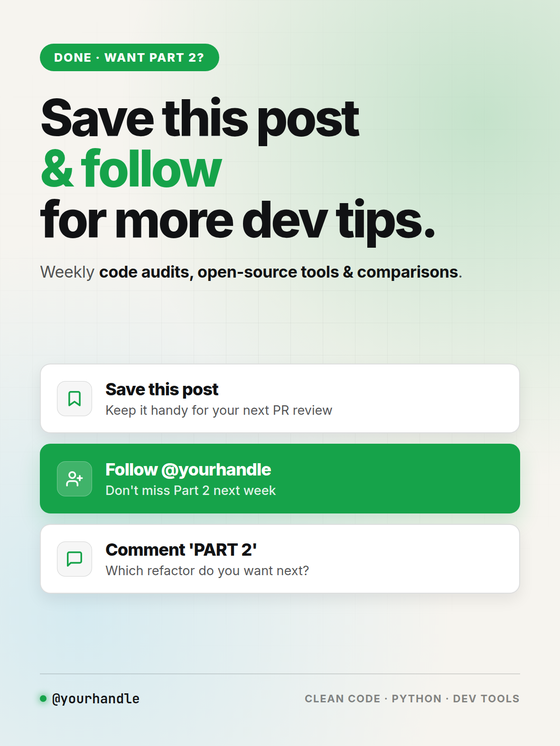<br />
      <sub><b>05 · Closing CTA</b><br />Save / Follow / Comment</sub>
    </td>
  </tr>
</table>

### 2. Multi-Ratio Auto-Adaptation (`3:4` Portrait → `1:1` LinkedIn PDF)

Export multiple aspect ratios (`--ratios 3:4,4:5,1:1`) and a combined `carousel.pdf` (`--pdf`) in a single run without re-fetching sources. Notice how `layout: versus` automatically switches from **vertical stacked** (`3:4` / `4:5`) to **2-column side-by-side** (`1:1`):

<table>
  <tr>
    <td align="center" width="50%">
      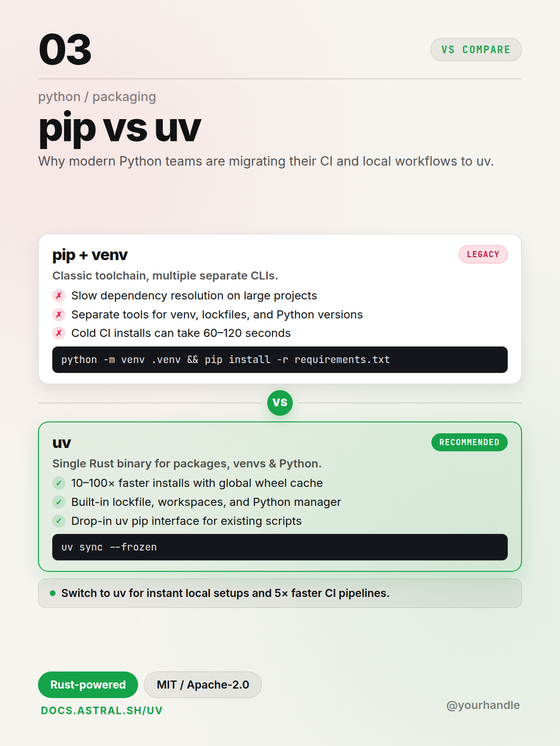<br />
      <sub><b>TikTok / Reels (<code>3:4</code> · 1180×1572)</b> — Stacked mobile cards</sub>
    </td>
    <td align="center" width="50%">
      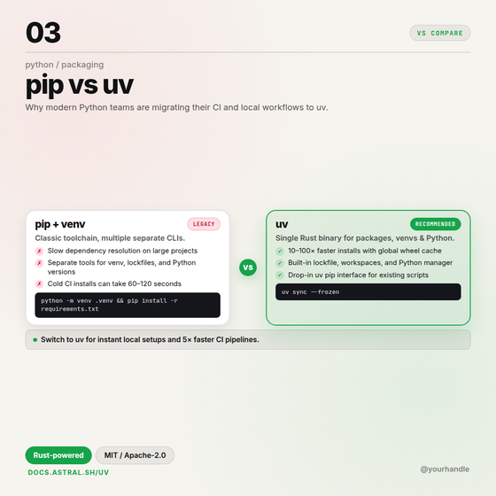<br />
      <sub><b>LinkedIn PDF (<code>1:1</code> · 1080×1080)</b> — Side-by-side comparison</sub>
    </td>
  </tr>
</table>

### 3. Interactive `preview.html` + Platform Safe-Zone Overlay

Every export includes an interactive `preview.html` with keyboard navigation (`←` / `→`) and toggleable **Platform Safe-Zone Overlays** (`S` key) for **TikTok**, **IG Reels**, **IG Carousel**, and **LinkedIn** so headlines, badges, and watermarks never collide with app UI:

<p align="center">
  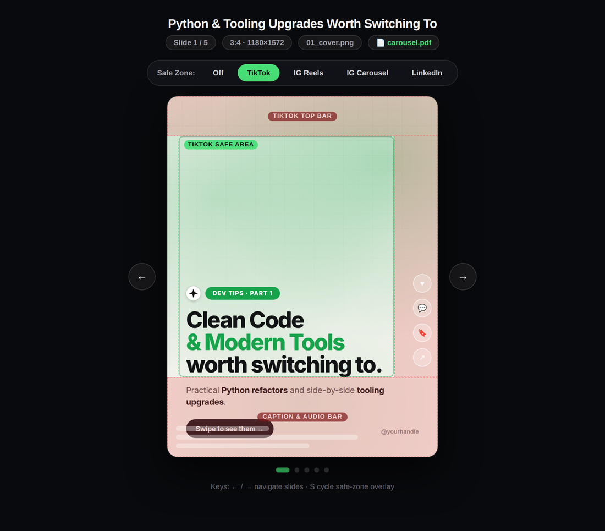
</p>

### 4. Built-in Themes (8 Modern Dark & Light Presets)

Pick your preferred theme with `--theme` (default: `midnight-emerald`), or pass your own `.yaml` brand theme with custom colors, dynamic Google Fonts, or offline `font_files`:

<table>
  <tr>
    <td align="center" width="25%">
      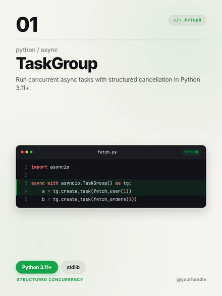<br />
      <sub><code>editorial-light</code> · Light Cream</sub>
    </td>
    <td align="center" width="25%">
      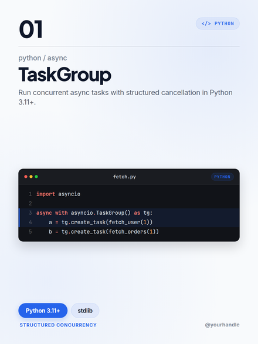<br />
      <sub><code>arctic-slate</code> · Light Cobalt</sub>
    </td>
    <td align="center" width="25%">
      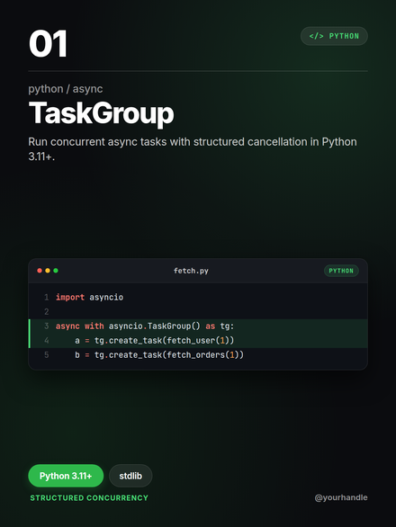<br />
      <sub><code>midnight-emerald</code> · Default</sub>
    </td>
    <td align="center" width="25%">
      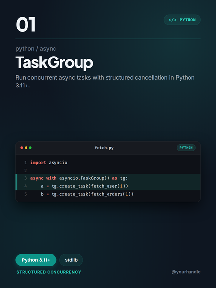<br />
      <sub><code>nord-frost</code> · Glacier Teal</sub>
    </td>
  </tr>
  <tr>
    <td align="center" width="25%">
      <br />
      <sub><code>cyber-indigo</code> · Deep Sky</sub>
    </td>
    <td align="center" width="25%">
      <br />
      <sub><code>neon-violet</code> · Ultraviolet</sub>
    </td>
    <td align="center" width="25%">
      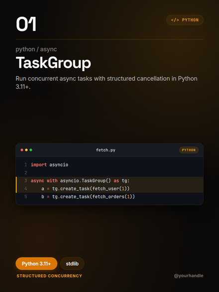<br />
      <sub><code>amber-noir</code> · Carbon Gold</sub>
    </td>
    <td align="center" width="25%">
      <br />
      <sub><code>crimson-carbon</code> · Signal Rose</sub>
    </td>
  </tr>
</table>

Run `swipekit themes` to list all installed presets or pass `--theme ./my_brand_theme.yaml` to use your own brand palette.

---

## Features

- **Multi-Source Content Engine**
  - **GitHub Source (`generate github`):** Pulls trending repos (`daily` / `weekly` / `monthly`) or topic searches, live star counts, licenses, and smart-cropped README visuals.
  - **Website Source (`generate web`):** Captures crisp desktop screenshots from `sites.yml` via headless Chromium (with cookie-banner dismissal) and OpenGraph metadata extraction.
  - **Hybrid YAML Decks (`render`):** Combine GitHub repos, websites, **syntax-highlighted code/diff cards**, and **A-vs-B comparison cards** in one editable `deck.yaml`.
- **Multi-Ratio Batch & LinkedIn PDF Export**
  - Supported ratios: `3:4` (`1180×1572`), `4:5` (`1080×1350`), `9:16` (`1080×1920`), `1:1` (`1080×1080`).
  - Render multiple ratios in one browser session (`--ratios 3:4,4:5,1:1` or `--ratios all`) and bundle `carousel.pdf` (`--pdf`) for LinkedIn Document Carousels.
- **Creator Brand Profile (`.swipekit.yaml`)**
  - Save default theme, watermark, language (`en` / `id`), cover photo, closing CTA (`outro`), and export flags once (`swipekit init profile`), then override per run via CLI.
- **Dynamic Google Fonts & Offline Local Fonts**
  - Automatically loads whatever `font_heading`, `font_body`, and `font_mono` your theme defines, or embeds local `.woff2`/`.ttf`/`.otf` files via `@font-face` (`font_files`) for 100% offline rendering.
- **Ready-to-Post Output Bundle**
  - Numbered PNG slides (`01_cover.png` … `NN_closing_cta.png`), optional `carousel.pdf`, ready-to-paste `caption.md` (with hashtags & links), editable `deck.yaml` snapshot, and `preview.html` with Safe-Zone HUD.

---

## Quick Start

### 1. Install

```bash
git clone https://github.com/try-catch-dev/TCD-Swipekit.git
cd TCD-Swipekit

pip install -e ".[dev]"
playwright install chromium
```

### 2. Try the Demo Deck (Offline, Zero API Keys)

```bash
swipekit render examples/code_and_versus_deck.yaml \
  --ratios 3:4,4:5,1:1 \
  --pdf \
  --output ./out/demo
```

Open `./out/demo/3x4/preview.html` in your browser and press **`S`** to toggle Platform Safe-Zone Overlays.

### 3. Set Up Your Creator Brand Profile (Optional)

```bash
# Local project profile (.swipekit.yaml) or global (~/.config/swipekit/config.yaml)
swipekit init profile
swipekit init profile --global

# Inspect active profile defaults
swipekit profile
```

### 4. Generate from GitHub Trending or Topic

```bash
# Weekly trending repos + automatic Save/Follow Closing CTA + LinkedIn PDF
swipekit generate github \
  --topic "ai" \
  --limit 5 \
  --lang en \
  --theme midnight-emerald \
  --watermark "@yourhandle" \
  --outro \
  --ratios 3:4,4:5,1:1 \
  --pdf \
  --output ./out/github_ai
```

### 5. Generate from Useful Websites (`sites.yml`)

```bash
swipekit init sites
swipekit generate web --sites examples/sites.yml --outro --pdf --output ./out/useful_websites
```

---

## Slide Layouts

Every item in `deck.yaml` supports three layouts (`layout` is auto-inferred when `code_block` or `versus` is set):

| Layout | Purpose | Key YAML Fields |
| :--- | :--- | :--- |
| `showcase` *(default)* | GitHub repo, website screenshot, or product card | `screenshot_path`, `repo`, `url`, `badges`, `command_or_url` |
| `code` | Syntax-highlighted code window or terminal diff | `code_block.code`, `language`, `filename`, `diff_mode`, `highlight_lines` |
| `versus` | Before/After or Tool A vs Tool B comparison | `versus.left`, `versus.right`, `points`, `code`, `accent`, `verdict` |

<details>
<summary><b>Example: <code>code</code> &amp; <code>versus</code> YAML snippet</b></summary>

```yaml
items:
  - source: manual
    eyebrow: "python / refactor"
    title: "Avoid N+1 Loops"
    description: "Replace nested dictionary lookups with a single indexed dict comprehension."
    code_block:
      filename: "orders_service.py"
      language: "diff"
      diff_mode: true
      code: |
        - for order in orders:
        -     for u in users:
        -         if u["id"] == order["user_id"]:
        -             order["user"] = u
        + user_by_id = {u["id"]: u for u in users}
        + for order in orders:
        +     order["user"] = user_by_id.get(order["user_id"])
    badges:
      - { text: "O(n²) → O(n)", style: "accent" }

  - source: manual
    eyebrow: "python / packaging"
    title: "pip vs uv"
    description: "Why modern Python teams migrate local & CI workflows to uv."
    versus:
      left:
        label: "pip + venv"
        badge: "LEGACY"
        points: ["Slow resolution on large repos", "Multiple separate CLIs"]
        code: "pip install -r requirements.txt"
      right:
        label: "uv"
        badge: "RECOMMENDED"
        points: ["10–100× faster installs", "Single Rust binary + lockfile"]
        code: "uv sync --frozen"
        accent: true
      verdict: "Switch to uv for instant setups and 5× faster CI."
```

</details>

<details>
<summary><b>Example: <code>sites.yml</code> &amp; <code>.swipekit.yaml</code> Creator Profile</b></summary>

```yaml
# sites.yml
topic: "Useful Websites for Developers"
language: en          # en (default) | id
aspect_ratio: "3:4"   # 3:4 | 4:5 | 9:16 | 1:1
part: 1

theme:
  preset: cyber-indigo
  watermark: "@yourhandle"

sites:
  - url: "https://excalidraw.com"
    title: "Excalidraw"
    description: "Virtual hand-drawn whiteboard for architecture diagrams and wireframes."
    pricing: "Free"
    category: "Whiteboard"
    footnote: "OPEN SOURCE · REAL-TIME COLLAB"
    footnote_accent: true
```

```yaml
# .swipekit.yaml (Creator Brand Profile — precedence: CLI > YAML file > Profile > Defaults)
theme: midnight-emerald
watermark: "@yourhandle"
watermark_position: bottom-right
language: en
ratios: ["3:4", "4:5", "1:1"]
export_pdf: true
outro:
  enabled: true
  badge_text: "DONE · WANT PART 2?"
```

</details>

---

## CLI Reference

| Command | Description |
| :--- | :--- |
| `swipekit generate github [OPTIONS]` | Fetch trending/topic GitHub repos & render carousel |
| `swipekit generate web --sites sites.yml [OPTIONS]` | Auto-capture website screenshots & render carousel |
| `swipekit render deck.yaml [OPTIONS]` | Render or re-render a custom/hybrid YAML deck |
| `swipekit init [sites\|deck\|profile]` | Scaffold starter `sites.yml`, `deck.yaml`, or `.swipekit.yaml` (`--global`) |
| `swipekit profile` | Show active Creator Brand Profile & resolved defaults |
| `swipekit themes` | List built-in theme presets |
| `swipekit doctor` | Verify Python, Chromium/Playwright, dependencies, and optional tokens |
| `swipekit skill install --agent <name>` | Install the TCD-Swipekit AI Agent Skill |

**Useful Shared Flags:** `--ratios 3:4,4:5,1:1` (or `all`) · `--pdf` · `--outro / --no-outro` · `--theme <preset|file.yaml>` · `--lang en|id` · `--watermark "@handle"` · `--profile <file>` · `--no-profile` · `--ai`

---

## Install as an AI Agent Skill

TCD-Swipekit follows the **Agent Skills Open Standard** ([`skills/tcd-swipekit/SKILL.md`](skills/tcd-swipekit/SKILL.md)), compatible with **Antigravity, Claude Code, Codex, Cursor, Gemini CLI, and GitHub Copilot**.

```bash
# Option 1 — Via skills CLI (npx)
npx skills add try-catch-dev/TCD-Swipekit

# Option 2 — Via built-in swipekit CLI
swipekit skill install --agent antigravity   # or claude, codex, cursor, gemini, copilot, all
swipekit skill show
```

---

## Environment Variables (Optional)

TCD-Swipekit runs **100% without API keys** by default. Two optional environment variables unlock extra capacity:

- **`GITHUB_TOKEN`** — Raises the GitHub API rate limit from 60 to 5,000 requests/hour when generating many GitHub decks.
- **`OPENAI_API_KEY`** (with `pip install -e ".[ai]"`) — Enables `--ai` to polish descriptions with an OpenAI-compatible LLM (`OPENAI_BASE_URL` and `SWIPEKIT_AI_MODEL` are also supported).

```bash
export GITHUB_TOKEN="ghp_..."
export OPENAI_API_KEY="sk-..."
swipekit doctor
swipekit generate github --topic "devtools" --outro --ai
```

---

## Project Structure

```text
TCD-Swipekit/
├── docs/assets/                  # README showcase visuals
├── examples/                     # Ready-to-run sites.yml, deck.yaml & code_and_versus_deck.yaml
├── skills/tcd-swipekit/          # Agent Skills standard SKILL.md + schema/theme references
├── src/tcd_swipekit/
│   ├── cli.py                    # Typer + Rich CLI (`swipekit`)
│   ├── pipeline.py               # Orchestration API (multi-ratio, PDF, profile precedence)
│   ├── profile.py                # Creator Brand Profile discovery & loader
│   ├── models.py                 # Pydantic v2 schemas (DeckSpec, CodeBlock, VersusBlock, etc.)
│   ├── i18n.py                   # EN (default) & ID localization
│   ├── copywriter.py             # Cover/outro defaults, caption builder, optional AI enhancer
│   ├── image_utils.py            # Smart border cropping & ambient color extraction
│   ├── renderer.py               # Jinja2 + Playwright PNG/PDF renderer + Pygments highlighter
│   ├── sources/                  # github.py, website.py, manual.py, base.py
│   └── themes/
│       ├── loader.py             # Preset & custom YAML theme loader (with local font_files)
│       ├── presets/              # 8 built-in dark & light presets (+ custom .yaml)
│       └── templates/            # cover, slide, slide_code, slide_versus, outro, preview
└── tests/
```

---

## Contributing & Community

Contributions are welcome — new theme presets, slide layouts, and content sources make great first PRs!

- [Contributing Guide](CONTRIBUTING.md) · [Changelog](CHANGELOG.md) · [Code of Conduct](CODE_OF_CONDUCT.md) · [Security Policy](SECURITY.md)

```bash
ruff check src tests
pytest -v
```

## License

MIT © [Try Catch Dev](https://github.com/try-catch-dev)
